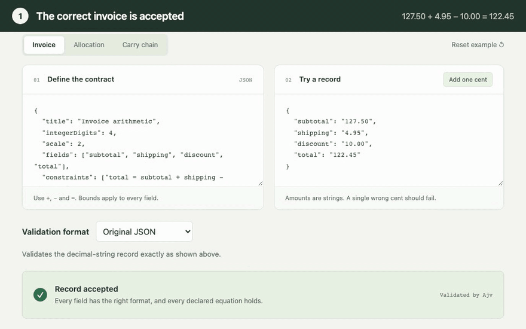

# Schema Calc

**An invoice that checks its own arithmetic—with an ordinary JSON Schema.**

Write an equation. Compile it once. Hand the resulting `.schema.json` to a standard validator in another language. It can reject a one-cent error without installing Schema Calc.

```text
total = subtotal + shipping - discount
                   │
                   ▼
          invoice.schema.json
                   │
                   ▼
     Ajv (JavaScript) / jsonschema (Python)

127.50 + 4.95 - 10.00 = 122.45     ✓ accepted
127.50 + 4.95 - 10.00 = 122.46     ✗ rejected
```

The input stays a normal flat JSON object:

```json
{"subtotal":"127.50","shipping":"4.95","discount":"10.00","total":"122.45"}
```

JSON Schema has no built-in operator for adding values from different properties. Schema Calc compiles **bounded decimal equations and inequalities into a finite carry machine**, then expresses that machine using standard conditionals, digit patterns and references. The validator becomes the execution engine.

The example schema is **41,391 bytes**, down from **284,300 bytes** for the first construction, with the same input and numeric bounds. No gzip, custom keywords, `$data`, arithmetic callbacks, or remotely fetched schemas are involved. Both independent validators check the actual exported file.

**[Try it in your browser](https://fmindstormer.github.io/schema-calc/)** · **[Download v0.6.0](https://github.com/fMindstormer/schema-calc/releases/tag/v0.6.0)**: the invoice schema, both records and a standalone Python validator.

[One cent, two validators](#one-cent-two-validators) · [Computational model](#the-computational-model) · [Compression](#where-the-compression-comes-from) · [Verification](#verification) · [Research notes](#explore-the-project)

## One cent, two validators

<picture>
  <source media="(prefers-reduced-motion: reduce)" srcset="docs/demo.png">
  
</picture>

1. The [playground](https://fmindstormer.github.io/schema-calc/) accepts the correct invoice.
2. **Add one cent** changes only the total, to 122.46, and the generated schema rejects it.
3. Download the schema, the record and `validate.py`.
4. Stock Python `jsonschema` rejects the record too, in a fresh environment where Schema Calc was never installed.

The captions are added by the recording; the terminal panel replays the commands and their output as captured from that run, on the files the browser had just downloaded ([scripts/demo/record.mjs](scripts/demo/record.mjs)). [scripts/check-handoff.mjs](scripts/check-handoff.mjs) repeats the handoff in CI for accepted and one-cent records in both encodings.

### Reproduce it without cloning

You need Python 3 and `jsonschema` 4.25.1; not Node, and not this repository:

```sh
python3 -m pip install jsonschema==4.25.1
base=https://github.com/fMindstormer/schema-calc/releases/download/v0.6.0
for f in validate.py invoice.schema.json invoice.valid.json invoice.invalid.json; do curl -fLO "$base/$f"; done
python3 validate.py invoice.schema.json invoice.valid.json invoice.invalid.json
```

```text
ACCEPT  invoice.valid.json
REJECT  invoice.invalid.json
  fails: total = subtotal + shipping - discount
```

`validate.py` is a short script that never imports the compiler. Under each `REJECT` it says why: the constraints the record breaks, or what is wrong with its format. It exits with 1 when any record is rejected. For a record you edited yourself, use the playground's two download buttons: the page prints the matching command and the output to expect.

## Run it locally

Requires Node.js 20 or newer; Node 24 is the reference development version.

```sh
npm ci
npm run demo
```

The demo loads the checked-in invoice schema directly into stock Ajv. It prints `ACCEPT` for the correct total and `REJECT` for the one-cent error. It never imports the compiler. The equivalent independent Python example is [examples/validate.py](examples/validate.py).

For the browser playground:

```sh
npm run build
npm start
```

Open [localhost:4173](http://127.0.0.1:4173), change the record, click **Add one cent**, and download the schema. Try an allocation that must sum to 100, `999.99 + 0.01 = 1000.00` to exercise a long carry, an even split, where two inequalities hold each share to a third of the total rounded down to the cent, or line items, each its net plus tax, that add up to the total. Compilation and validation run locally in a browser worker; the built playground needs no external assets or services.

## What is it useful for?

A schema can travel with a dataset, configuration file or API contract. Schema Calc lets that artifact carry exact reconciliation rules too: totals, percentage budgets, balances, or quantities that must add up. A receiving system needs a compatible Draft 2020-12 validator, rather than an implementation of each rule in each host language.

Eight rules of EN 16931, the European e-invoicing standard, compile into one schema for each of its two syntaxes, stating each rule as the official Schematron checks it: the document totals, BR-CO-10 to BR-CO-16, and BR-CO-17, each VAT category's tax as its taxable amount times its rate, for a listed set of rates. On the official example invoices and 770 changed copies of them, the schemas give the Schematron's verdict on all 804, rule by rule; see [EN 16931 totals in plain JSON Schema](docs/en16931.md).

This is a research prototype with a working compiler, CLI and playground. Its advantage is the portable contract. A handwritten arithmetic check is much smaller and usually faster when you control the receiving application. Schema Calc checks a supplied answer; it does not fill in a missing total.

## Compile your own contract

[examples/invoice.contract.json](examples/invoice.contract.json):

```json
{
  "title": "Invoice arithmetic",
  "integerDigits": 4,
  "scale": 2,
  "fields": ["subtotal", "shipping", "discount", "total"],
  "constraints": ["total = subtotal + shipping - discount"]
}
```

```sh
node bin/schema-calc.mjs examples/invoice.contract.json invoice.schema.json
```

Omit the output path to write JSON to stdout. Diagnostics go to stderr. The JavaScript API is dependency-free and works in Node or a browser:

```js
import { compile } from './src/compiler.mjs';

const { schema, stats } = compile({
  fields: ['research', 'engineering', 'operations'],
  integerDigits: 3,
  scale: 2,
  constraints: ['research + engineering + operations = 100.00']
});
```

A few validators refuse resources embedded inside other resources, which the default layout uses to save bytes. `--defs` on the command line, or `compile(spec, { layout: 'defs' })`, declares every shared resource in a root `$defs` instead, for 13–21% more bytes; the [compatibility table](compat/README.md) shows which validators need it. `compile(spec, { maxDepth, maxSubschemas, maxDefinitions })` changes the 32-level nesting limit, the limit of 2,000 subschemas between references and the budget of 40,000 definitions.

A list's sum reads each column through how many lines have each digit there, with `contains`, `minContains` and `maxContains`, rather than reading every line in turn. `compile(spec, { listSums: 'positions' })` reads each position instead, through a `prefixItems` tuple that stops at that position; Ajv's default strict mode logs a warning for every such partial tuple, and `strict: true` refuses it unless `strictTuples` is off.

Ajv is a development dependency for the demo, tests and playground; it is not part of the compiler or the exported schema. See the runnable [JavaScript](examples/validate.mjs) and [Python](examples/validate.py) examples for the independent-validator handoff.

### Why a record fails

A validator's verdict is a yes or a no, and its error messages point into a decision graph. To say which constraint a rejected record breaks, the compiler marks each constraint's subschema with its source in `$comment` and, if the contract names it, its name in `title`. [examples/validate.py](examples/validate.py) reads these from Python `jsonschema`'s own errors, with nothing else installed, and prints them under `REJECT`:

```text
REJECT  invoice.invalid.json
  fails: total = subtotal + shipping - discount
```

A constraint on each line lists the lines that break it, as JSON Pointers: `fails: lines.amount = lines.net + lines.tax at /lines/0`. A named constraint prints its name: `fails BR-CO-13: totalWithoutVat = lineNetTotal - allowanceTotal + chargeTotal`. When the record's format is wrong, its arithmetic means nothing, so the report lists the format problems instead: `missing: /total`, `unexpected: /note`, `invalid: /lines/2/net`. In JavaScript, `prepareValidator(schema).failures(record)` gives the same report as an object, checking the format with a schema of the format alone and each constraint with its own subschema; [describeFailures](src/failures.mjs) prints it as `validate.py` does. The playground shows it under the verdict.

Only a rejected record needs a report, and it costs about as much as validating it again. The verdict never depends on it. The tests compare every report with schemas compiled from one constraint at a time, and Python's report with Ajv's on every rejected record of the test corpora; on [EN 16931](docs/en16931.md), each report names exactly the rules the official Schematron finds broken.

### Input contract

| Supported | Boundary |
|---|---|
| Field names, decimal constants, `+`, `-` | No division or parentheses |
| `=`, `<=`, `>=`, `<`, `>` | No chains such as `a <= b <= c`, and no `!=` |
| Lists of amounts, `"lists": {"lines": 10}`, summed with `sum(lines)` | Up to 4 lists of up to 20 items; a missing item counts as zero in a sum; no indexing, and no tally encoding |
| Lists of objects, `"lines": {"maxItems": 10, "fields": ["net", "tax"]}`, summed with `sum(lines.net)` | Up to 4 amount fields per item, required unless the list declares them `"optional"`; other item properties, such as a description, are allowed |
| Constraints on each line, `lines.amount = lines.net + lines.tax` | Lists of objects only; one line's fields and constants, not top-level fields, sums or other lines |
| Whole-number coefficients: `3 * a` or `a * 3` | From 1 to 1,000 |
| A field with listed values, `"values": {"rate": ["0", "7", "19"]}`, times another field: `rate * base` | One such field per relation, multiplying fields rather than sums; the field takes only its listed values, up to 32; one relation is compiled for each value; no other products of fields, and no tally encoding |
| `abs(x)`, an amount without its sign | One field or one line's field; no tally encoding |
| Repeated terms, unary signs, several constraints at once | Up to 16 fields, 8 constraints and 16 source terms per constraint |
| A name for a constraint, `{"name": "BR-CO-13", "constraint": "..."}`, for [reports](#why-a-record-fails) | 1–64 printable characters; it changes no verdict |
| Exact decimal **strings**, nonnegative unless `"signed": true` allows a leading minus sign | No JSON numbers, plus signs, exponents or leading zeroes; no tally encoding for signed amounts |
| Optional fields, `"optional": ["paid"]`, which count as zero when absent | On the record, or in a list's declaration for its items' fields; no tally encoding |
| Relations joined by `and` and `or`, and `has paid` or `no paid` for an optional field or a list: `has paid and due = total - paid or no paid and due = total` | `and` binds first; no parentheses or `not`; up to 8 relations and tests per constraint; on each line, relations on that line and `has lines.x` for its optional fields; `and`, `or`, `has` and `no` cannot name fields; no tally encoding |
| Shared precision across fields | 1–10 integer digits, 0–4 fractional digits, at most 12 total digits |
| Signed intermediate balances and constants | Overflow and negative results never wrap around |

All declared fields except optional ones, and all lists, are required, and extra top-level properties are rejected. With four integer digits and scale two, each value must be between `"0.00"` and `"9999.99"`, with exactly two fractional digits. Whitespace, trailing newlines and non-ASCII digits fail validation. Coefficients enlarge the schema: `total = k * price + shipping`, with four integer and two fractional digits, compiles to 21 kB with `k` = 1, 47 kB with 9, 233 kB with 99 and 832 kB with 999. Trailing zeros cost nothing, since a coefficient c × 10ᵏ reads its field k columns later with coefficient c: 10, 100 and 1,000 compile to 14–19 kB. A field with listed values compiles its relation once for each value, so its size is the sum of theirs. A 40,000-definition budget can reject especially large contracts even within the syntax limits. The tally encoding repeats a field once per unit of its coefficient, so it refuses coefficients above 16. Signed amounts make a schema about four times larger: 3.6–4.7 times for the shipped examples. A list grows the schema faster than its length, because each column's sum can take more values: `sum(lines) = subtotal` at the same precision is 16 kB for one line, 72 kB for 4, 240 kB for 10 and 682 kB for 20. Lines that are objects with an `amount` field cost 3–13% more. A constraint on each line is compiled once and applied to every line, so its size does not depend on the list's length: on its own, `lines.amount = lines.net + lines.tax` compiles to 20.5 kB for 4 lines or for 20. Nested objects other than list items, and custom arithmetic error messages, are outside the current compiler.

## The computational model

Think of a finite-state machine reading several numbers **one column at a time, from right to left**. Its memory is a signed carry, not the complete numbers.

Normalize an equality to `Σ cᵢxᵢ + C = 0`, and interpret each decimal string as an integer in minor units. At decimal position `j`, with digits `dᵢⱼ`, signed constant digit `kⱼ` and incoming carry `rⱼ`, the machine's transition is:

```text
s = rⱼ + Σ cᵢdᵢⱼ + kⱼ

s not divisible by 10  → reject
s divisible by 10      → continue with carry s / 10
```

For the invoice above, the least significant column of `subtotal + shipping - discount - total` is `0 + 5 - 0 - 5 = 0`. Changing the total's last digit to 6 makes it −1. No higher decimal column can repair that remainder.

An inequality normalizes to `Σ cᵢxᵢ + C ≤ 0`: `≥` and `>` negate both sides, and since every value is a whole number of minor units, `<` adds one unit to `C`. A remainder no longer rejects. Write `s = 10q + r` with `0 ≤ r < 10`. Every higher column contributes a multiple of 10, so only whether `r > 0` matters, and the machine continues with carry `⌈s / 10⌉`. After the last column it accepts when the carry, plus the constant's part above the field width, is at most zero.

The compiler precomputes every reachable transition. A compiled state records `(position, radix stage, next field, signed balance)`. Its target language is a **shared, acyclic decision graph**:

| Machine operation | Standard JSON Schema representation |
|---|---|
| Inspect a digit or set of digits | `properties` + a positional `pattern` |
| Select a transition | `if` / `then` / `else` |
| Reuse a continuation | `$ref` to an embedded schema resource |
| Require several conditions | `allOf`, or compatible sibling assertions |
| Accept / reject | Boolean schemas `true` / `false` |

The regexes inspect individual fields; they do not compare strings across properties. Bounded width unrolls the carry machine into an acyclic graph. The validator follows schema assertions, with no runtime arithmetic hook and no arithmetic witness in the input.

**Why it is correct:** after the first `j` columns, their signed contribution equals `10ʲ × carry`. A nonzero lower-column remainder cannot be cancelled by unprocessed columns. Induction preserves this invariant; after the final column, the carry must cancel any remaining high digits of the constant. This handles negative carries and prevents overflow from wrapping. Root shape checks establish the decimal-string assumptions.

This is finite-state compilation of a bounded linear relation. It makes no claim of unbounded arithmetic or Turing completeness. [docs/design.md](docs/design.md) gives the normalization, transition identities, packing argument and proof in detail.

## Where the compression comes from

The straightforward machine already avoids enumerating complete records, but its whole-decimal transitions produce a large schema. Compression changes both the decision graph and how that graph is serialized.

1. **Factor a decimal digit into radix 2 and radix 5.** Write `d = p + 2q`, with `p = d mod 2` and `q = floor(d/2)`. Read the parity components first and divide the balance by two; then read the quotient components and divide by five, rejecting a nonzero remainder at either stage. Together these steps implement the same decimal carry. Smaller intermediate balance ranges mean fewer distinct states. These are successive carry steps, not independent congruence tests.
2. **Share continuations, rather than repeat subtrees.** Memoize states, group component values with the same continuation, balance their tests, collapse identical branches, and intern equivalent predicates. A reference shares the program's representation; it does not promise that a validator caches its result.
3. **Exploit the established input domain.** Short positional regexes rely on the root's canonical format. Missing leading digits behave as zero. Complementing digit sets when needed lets predicates exclude zero and avoids explicit padding alternatives. String predicates are shared across fields.
4. **Pay for references only when they save bytes.** Compare inlining against sharing, prune unreachable nodes, merge compatible conjunctions, and declare a remaining shared resource at its first use with a short `$id`. Later uses refer to it by a short `$ref`, removing a separate definition entry and its first reference. Where that embedding would nest the file deeper than 32 levels, the tallest subschemas move into `$defs` instead.

The result is a standard [Compound Schema Document](https://json-schema.org/understanding-json-schema/structuring#bundling). All resources are inside the one file. Its `schema-calc.invalid` identifiers are namespaces, not network endpoints.

| Example | Whole-decimal baseline | Mixed-radix graph | Packed graph: current default |
|---|---:|---:|---:|
| Invoice | 284,300 B | 57,050 B | **41,391 B** |
| Allocation | 94,025 B | 21,935 B | **16,474 B** |
| Carry chain | 129,290 B | 28,167 B | **20,632 B** |

These are compact UTF-8 JSON bytes, excluding the final newline, for identical contracts and domains. The invoice shrinks **85.4%** overall. The even split (`3 * share <= total`, `total < 3 * share + 0.03`) is 26,755 B, and the line items (`lines.amount = lines.net + lines.tax` and `sum(lines.amount) = total`, for up to four lines) 95,921 B; the earlier compilers predate coefficients, inequalities and lists. Frozen compilers and the [benchmark guide](bench/README.md) make the comparison reproducible.

Version 0.1.0 emitted 41,232, 16,315 and 20,510 B. The current output spends 95 to 132 bytes more on an end-of-string check without lookahead and a 32-level nesting limit, so that validators in more languages load it, and 27 more on a root reference that lets Python `jsonschema` crawl the document once per validation; see the [compatibility table](compat/README.md) and [design.md](docs/design.md#graph-reduction-and-schema-packing). Timings and sizes recorded under `bench/` and in the experiment notes were measured on the 0.1.0 files.

For one equation with `D` decimal positions and `N` non-cancelled fields, a selected path needs at most `4DN` digit predicates: one binary and at most three quinary decisions per field and position. The invoice's bound is 96. This counts abstract graph predicates, not validator instructions or elapsed time.

### Smallest is not fastest

Packing saves bytes but increases reference-resolution and preparation costs in the tested validators. The broader held-out invoice workload measured warm accepted validation at about **5.19 → 6.25 µs in Ajv** and **1.58 → 24.98 ms in Python** when moving from the larger mixed-radix schema to the packed default. These are local medians with compilation excluded; [the recorded results](bench/superoptimizer/results.json) contain the environment, samples and methodology.

The playground prepares an unbundled in-memory copy through public Ajv APIs to reduce setup cost. Downloads retain the original packed file, and independent tests validate that file directly. The default is a size choice, not a claim of universally better performance.

Two further experiments expose the trade-off:

- **Change the input representation:** a nine-token tally per digit lets standard `contains` / `minContains` / `maxContains` count the signed sum. Static recursion reuses a tiny carry machine across linked columns. The invoice schema falls to **3,569 B**, while its record grows from **75 to 676 B**. This optional mode changes the JSON supplied to the validator and adds conversion cost. The encoder preserves an incorrect total so the schema still has to reject it. See [docs/tally.md](docs/tally.md).
- **Search for better decision programs:** a bounded superoptimizer checks exhaustive local truth tables and searches conditional programs, including native `oneOf` tests. Its smallest searched invoice is **39,798 B**, but no candidate consistently improved size without slowing either validator on confirmation workloads. Smaller circuit prototypes also suffered repeated evaluation. The results remain experiments in [docs/superoptimizer.md](docs/superoptimizer.md) and [docs/experiments.md](docs/experiments.md).

The engineering problem is both representational and operational: how compactly can a standard schema describe the relation, and how much work will an ordinary validator do to interpret it?

## Verification

After `npm ci`, on macOS or Linux:

```sh
python3 -m venv .venv
.venv/bin/python -m pip install -r requirements-test.txt
npm test
npm run check:examples
npm run check:python
npm run check:tally
npm run build
npx playwright install chromium
npm run check:handoff
```

On Windows, use `.venv\Scripts\python` for the Python commands; see [CONTRIBUTING.md](CONTRIBUTING.md). Python 3.13 is the reference version. Tests pin Ajv 8.20.0, jsonschema 4.25.1 and Playwright 1.64.1.

The 62 Node tests cover the compiler, both representations, browser preparation, failure reports, the playground's one-cent shortcut and the bounded optimizer. `check:handoff` drives the built playground in Chromium, downloads its files and validates them with a fresh Python environment. The generated corpus is checked independently in both validators:

| Suite | Checks in each validator | Schemas |
|---|---:|---:|
| Original flat input | 45,451 | 92 |
| Tally input, including malformed encodings | 31,521 | 67 |
| Six experimental optimizer profiles | 146,868 | 204 |
| Exhaustive local optimizer fixtures | 22,828 | 1,328 |

The same flat, tally and example suites also run through ten more validators in JavaScript, Python, Go, Java and C#, each with its default options; see the [compatibility table](compat/README.md). None gives a wrong answer, and nine of the twelve load every schema. @cfworker/json-schema refuses resources nested inside other resources, and loads everything with the `--defs` layout. @exodus/schemasafe times out loading some of the largest, from about 170 kB up, such as those compiled from long lists or from products by listed values. jsonschema-rs runs out of memory loading the larger flat schemas in either layout.

Optimizer totals include repeated records across profiles. Its larger suites run separately via the [research commands](bench/README.md). Python also checks each schema against the Draft 2020-12 meta-schema, and, for up to 200 evenly spaced rejected records per flat or tally schema, that `validate.py` explains the rejection as Ajv's report does: 12,868 reports in all. Run on every rejected record of both corpora, 55,605 of them, the two reports were the same.

Coverage includes exhaustive small additions and comparisons, lists of every length up to their maximum, including empty and malformed lists and lines with other properties, constraints on each line, every one-digit signed sum, signed bounds and malformed signs, absent and explicit optional terms, optional fields of a line, relations joined by `and` and `or` with presence tests, on the record and on each line, against an independent oracle, `abs()`, coefficients ending in zeros, products by fields with listed values, including fractional and negative values, and BR-CO-17's rounded VAT tolerance against the Schematron's formula, every pair of two-digit addends, independent BigInt-oracle cases for equations and for inequalities one unit either side of the boundary, long carries, signed coefficients from 1 to 1,000 written either way round, repeated terms, combined-constant overflow, malformed values, reference closure and precision boundaries. Finite tests complement the carry proof; they do not prove every possible source contract. The [Verify schemas](.github/workflows/ci.yml) workflow runs the Node suites and build on Node 20 and 24, the Python suites once, and the browser handoff, on pushes and pull requests. [Validator compatibility](.github/workflows/compat.yml) reruns the cross-language comparison when the compiler or examples change. [Release links](.github/workflows/release-links.yml) fails if the release this README links is missing or lacks a file it downloads.

## Explore the project

| Start here | What you will find |
|---|---|
| [src/compiler.mjs](src/compiler.mjs), [src/resources.mjs](src/resources.mjs) | Carry-state generation, decision reduction and resource packing |
| [examples/](examples/) | Contracts, ready-to-use schemas and accepted/rejected records |
| [docs/design.md](docs/design.md) | The flat-input model and proof |
| [docs/tally.md](docs/tally.md) | Native counting, recursive carries and representation costs |
| [docs/experiments.md](docs/experiments.md), [docs/flat-experiment.md](docs/flat-experiment.md) | Successful and rejected compression approaches |
| [docs/superoptimizer.md](docs/superoptimizer.md) | Search grammar, exhaustive local checks and confirmation results |
| [compat/README.md](compat/README.md) | The schemas in twelve validators across five languages |
| [docs/en16931.md](docs/en16931.md) | EN 16931 invoice totals, compared with the official Schematron |
| [bench/README.md](bench/README.md) | Reproducing results and interpreting timings |
| [CONTRIBUTING.md](CONTRIBUTING.md) | Development and evidence required for compiler changes |
| [docs/releasing.md](docs/releasing.md) | Preparing a source archive and a GitHub release |

Arithmetic automata, decision diagrams and radix decomposition are established techniques. This project's contribution is an inspectable compiler into a restrictive, widely implemented format, together with portable artifacts and measured compression trade-offs. It makes no priority claim; [docs/prior-art.md](docs/prior-art.md) relates it to Presburger arithmetic automata and existing JSON Schema research.

## License

[MIT](LICENSE).
