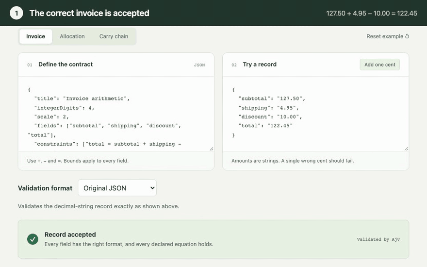

# Schema Calc

**An invoice that checks its own arithmetic—with an ordinary JSON Schema.**

Write an equation. Compile it once. Hand the resulting `.schema.json` to a standard validator in another language. It can reject a one-cent error without installing Schema Calc.

```text
total = subtotal + shipping - discount
                   │
                   ▼
          invoice.schema.json
                   │
                   ▼
     Ajv (JavaScript) / jsonschema (Python)

127.50 + 4.95 - 10.00 = 122.45     ✓ accepted
127.50 + 4.95 - 10.00 = 122.46     ✗ rejected
```

The input stays a normal flat JSON object:

```json
{"subtotal":"127.50","shipping":"4.95","discount":"10.00","total":"122.45"}
```

JSON Schema has no built-in operator for adding values from different properties. Schema Calc compiles **bounded decimal equalities into a finite carry machine**, then expresses that machine using standard conditionals, digit patterns and references. The validator becomes the execution engine.

The example schema is **41,232 bytes**, down from **284,300 bytes** for the first construction, with the same input and numeric bounds. No gzip, custom keywords, `$data`, arithmetic callbacks, or remotely fetched schemas are involved. Both independent validators check the actual exported file.

**[Try it in your browser](https://fmindstormer.github.io/schema-calc/)** · **[Download v0.1.0](https://github.com/fMindstormer/schema-calc/releases/tag/v0.1.0)**: the invoice schema, both records and a standalone Python validator.

[One cent, two validators](#one-cent-two-validators) · [Computational model](#the-computational-model) · [Compression](#where-the-compression-comes-from) · [Verification](#verification) · [Research notes](#explore-the-project)

## One cent, two validators

<picture>
  <source media="(prefers-reduced-motion: reduce)" srcset="docs/demo.png">
  
</picture>

1. The [playground](https://fmindstormer.github.io/schema-calc/) accepts the correct invoice.
2. **Add one cent** changes only the total, to 122.46, and the generated schema rejects it.
3. Download the schema, the record and `validate.py`.
4. Stock Python `jsonschema` rejects the record too, in a fresh environment where Schema Calc was never installed.

The captions are added by the recording; the terminal panel replays the commands and their output as captured from that run, on the files the browser had just downloaded ([scripts/demo/record.mjs](scripts/demo/record.mjs)). [scripts/check-handoff.mjs](scripts/check-handoff.mjs) repeats the handoff in CI for accepted and one-cent records in both encodings.

### Reproduce it without cloning

You need Python 3 and `jsonschema` 4.25.1; not Node, and not this repository:

```sh
python3 -m pip install jsonschema==4.25.1
base=https://github.com/fMindstormer/schema-calc/releases/download/v0.1.0
for f in validate.py invoice.schema.json invoice.valid.json invoice.invalid.json; do curl -fLO "$base/$f"; done
python3 validate.py invoice.schema.json invoice.valid.json invoice.invalid.json
```

```text
ACCEPT  invoice.valid.json
REJECT  invoice.invalid.json
```

`validate.py` is a short script that never imports the compiler; it exits with 1 when any record is rejected. For a record you edited yourself, use the playground's two download buttons: the page prints the matching command and the output to expect.

## Run it locally

Requires Node.js 20 or newer; Node 24 is the reference development version.

```sh
npm ci
npm run demo
```

The demo loads the checked-in invoice schema directly into stock Ajv. It prints `ACCEPT` for the correct total and `REJECT` for the one-cent error. It never imports the compiler. The equivalent independent Python example is [examples/validate.py](examples/validate.py).

For the browser playground:

```sh
npm run build
npm start
```

Open [localhost:4173](http://127.0.0.1:4173), change the record, click **Add one cent**, and download the schema. Try an allocation that must sum to 100, or `999.99 + 0.01 = 1000.00` to exercise a long carry. Compilation and validation run locally in a browser worker; the built playground needs no external assets or services.

## What is it useful for?

A schema can travel with a dataset, configuration file or API contract. Schema Calc lets that artifact carry exact reconciliation rules too: totals, percentage budgets, balances, or quantities that must add up. A receiving system needs a compatible Draft 2020-12 validator, rather than an implementation of each rule in each host language.

This is a research prototype with a working compiler, CLI and playground. Its advantage is the portable contract. A handwritten arithmetic check is much smaller and usually faster when you control the receiving application. Schema Calc checks a supplied answer; it does not fill in a missing total.

## Compile your own contract

[examples/invoice.contract.json](examples/invoice.contract.json):

```json
{
  "title": "Invoice arithmetic",
  "integerDigits": 4,
  "scale": 2,
  "fields": ["subtotal", "shipping", "discount", "total"],
  "constraints": ["total = subtotal + shipping - discount"]
}
```

```sh
node bin/schema-calc.mjs examples/invoice.contract.json invoice.schema.json
```

Omit the output path to write JSON to stdout. Diagnostics go to stderr. The JavaScript API is dependency-free and works in Node or a browser:

```js
import { compile } from './src/compiler.mjs';

const { schema, stats } = compile({
  fields: ['research', 'engineering', 'operations'],
  integerDigits: 3,
  scale: 2,
  constraints: ['research + engineering + operations = 100.00']
});
```

Ajv is a development dependency for the demo, tests and playground; it is not part of the compiler or the exported schema. See the runnable [JavaScript](examples/validate.mjs) and [Python](examples/validate.py) examples for the independent-validator handoff.

### Input contract

| Supported | Boundary |
|---|---|
| Field names, decimal constants, `+`, `-`, `=` | Equalities only; no multiplication, division, parentheses or comparisons |
| Repeated terms, unary signs, simultaneous equations | Up to 8 fields, 8 equations and 16 source terms per equation |
| Exact, nonnegative decimal **strings** | No JSON numbers, signed input strings, exponents or leading zeroes |
| Shared precision across fields | 1–10 integer digits, 0–4 fractional digits, at most 12 total digits |
| Signed intermediate balances and constants | Overflow and negative results never wrap around |

All declared fields are required and extra properties are rejected. With four integer digits and scale two, each value must be between `"0.00"` and `"9999.99"`, with exactly two fractional digits. Whitespace, trailing newlines and non-ASCII digits fail validation. A 40,000-definition budget can reject especially large contracts even within the syntax limits. Nested objects, arrays and custom arithmetic error messages are outside the current compiler.

## The computational model

Think of a finite-state machine reading several numbers **one column at a time, from right to left**. Its memory is a signed carry, not the complete numbers.

Normalize an equality to `Σ cᵢxᵢ + C = 0`, and interpret each decimal string as an integer in minor units. At decimal position `j`, with digits `dᵢⱼ`, signed constant digit `kⱼ` and incoming carry `rⱼ`, the machine's transition is:

```text
s = rⱼ + Σ cᵢdᵢⱼ + kⱼ

s not divisible by 10  → reject
s divisible by 10      → continue with carry s / 10
```

For the invoice above, the least significant column of `subtotal + shipping - discount - total` is `0 + 5 - 0 - 5 = 0`. Changing the total's last digit to 6 makes it −1. No higher decimal column can repair that remainder.

The compiler precomputes every reachable transition. A compiled state records `(position, radix stage, next field, signed balance)`. Its target language is a **shared, acyclic decision graph**:

| Machine operation | Standard JSON Schema representation |
|---|---|
| Inspect a digit or set of digits | `properties` + a positional `pattern` |
| Select a transition | `if` / `then` / `else` |
| Reuse a continuation | `$ref` to an embedded schema resource |
| Require several conditions | `allOf`, or compatible sibling assertions |
| Accept / reject | Boolean schemas `true` / `false` |

The regexes inspect individual fields; they do not compare strings across properties. Bounded width unrolls the carry machine into an acyclic graph. The validator follows schema assertions, with no runtime arithmetic hook and no arithmetic witness in the input.

**Why it is correct:** after the first `j` columns, their signed contribution equals `10ʲ × carry`. A nonzero lower-column remainder cannot be cancelled by unprocessed columns. Induction preserves this invariant; after the final column, the carry must cancel any remaining high digits of the constant. This handles negative carries and prevents overflow from wrapping. Root shape checks establish the decimal-string assumptions.

This is finite-state compilation of a bounded linear relation. It makes no claim of unbounded arithmetic or Turing completeness. [docs/design.md](docs/design.md) gives the normalization, transition identities, packing argument and proof in detail.

## Where the compression comes from

The straightforward machine already avoids enumerating complete records, but its whole-decimal transitions produce a large schema. Compression changes both the decision graph and how that graph is serialized.

1. **Factor a decimal digit into radix 2 and radix 5.** Write `d = p + 2q`, with `p = d mod 2` and `q = floor(d/2)`. Read the parity components first and divide the balance by two; then read the quotient components and divide by five, rejecting a nonzero remainder at either stage. Together these steps implement the same decimal carry. Smaller intermediate balance ranges mean fewer distinct states. These are successive carry steps, not independent congruence tests.
2. **Share continuations, rather than repeat subtrees.** Memoize states, group component values with the same continuation, balance their tests, collapse identical branches, and intern equivalent predicates. A reference shares the program's representation; it does not promise that a validator caches its result.
3. **Exploit the established input domain.** Short positional regexes rely on the root's canonical format. Missing leading digits behave as zero. Complementing digit sets when needed lets predicates exclude zero and avoids explicit padding alternatives. String predicates are shared across fields.
4. **Pay for references only when they save bytes.** Compare inlining against sharing, prune unreachable nodes, merge compatible conjunctions, and declare a remaining shared resource at its first use with a short `$id`. Later uses refer to it by a short `$ref`, removing a separate definition entry and its first reference.

The result is a standard [Compound Schema Document](https://json-schema.org/understanding-json-schema/structuring#bundling). All resources are inside the one file. Its `schema-calc.invalid` identifiers are namespaces, not network endpoints.

| Example | Whole-decimal baseline | Mixed-radix graph | Packed graph: current default |
|---|---:|---:|---:|
| Invoice | 284,300 B | 57,050 B | **41,232 B** |
| Allocation | 94,025 B | 21,935 B | **16,315 B** |
| Carry chain | 129,290 B | 28,167 B | **20,510 B** |

These are compact UTF-8 JSON bytes, excluding the final newline, for identical contracts and domains. The invoice shrinks **85.5%** overall. Frozen compilers and the [benchmark guide](bench/README.md) make the comparison reproducible.

For one equation with `D` decimal positions and `N` non-cancelled fields, a selected path needs at most `4DN` digit predicates: one binary and at most three quinary decisions per field and position. The invoice's bound is 96. This counts abstract graph predicates, not validator instructions or elapsed time.

### Smallest is not fastest

Packing saves bytes but increases reference-resolution and preparation costs in the tested validators. The broader held-out invoice workload measured warm accepted validation at about **5.19 → 6.25 µs in Ajv** and **1.58 → 24.98 ms in Python** when moving from the larger mixed-radix schema to the packed default. These are local medians with compilation excluded; [the recorded results](bench/superoptimizer/results.json) contain the environment, samples and methodology.

The playground prepares an unbundled in-memory copy through public Ajv APIs to reduce setup cost. Downloads retain the original packed file, and independent tests validate that file directly. The default is a size choice, not a claim of universally better performance.

Two further experiments expose the trade-off:

- **Change the input representation:** a nine-token tally per digit lets standard `contains` / `minContains` / `maxContains` count the signed sum. Static recursion reuses a tiny carry machine across linked columns. The invoice schema falls to **3,569 B**, while its record grows from **75 to 676 B**. This optional mode changes the JSON supplied to the validator and adds conversion cost. The encoder preserves an incorrect total so the schema still has to reject it. See [docs/tally.md](docs/tally.md).
- **Search for better decision programs:** a bounded superoptimizer checks exhaustive local truth tables and searches conditional programs, including native `oneOf` tests. Its smallest searched invoice is **39,798 B**, but no candidate consistently improved size without slowing either validator on confirmation workloads. Smaller circuit prototypes also suffered repeated evaluation. The results remain experiments in [docs/superoptimizer.md](docs/superoptimizer.md) and [docs/experiments.md](docs/experiments.md).

The engineering problem is both representational and operational: how compactly can a standard schema describe the relation, and how much work will an ordinary validator do to interpret it?

## Verification

After `npm ci`, on macOS or Linux:

```sh
python3 -m venv .venv
.venv/bin/python -m pip install -r requirements-test.txt
npm test
npm run check:examples
npm run check:python
npm run check:tally
npm run build
npx playwright install chromium
npm run check:handoff
```

On Windows, use `.venv\Scripts\python` for the Python commands; see [CONTRIBUTING.md](CONTRIBUTING.md). Python 3.13 is the reference version. Tests pin Ajv 8.20.0, jsonschema 4.25.1 and Playwright 1.64.1.

The 28 Node tests cover the compiler, both representations, browser preparation, the playground's one-cent shortcut and the bounded optimizer. `check:handoff` drives the built playground in Chromium, downloads its files and validates them with a fresh Python environment. The generated corpus is checked independently in both validators:

| Suite | Checks in each validator | Schemas |
|---|---:|---:|
| Original flat input | 24,469 | 31 |
| Tally input, including malformed encodings | 24,473 | 36 |
| Six experimental optimizer profiles | 146,868 | 204 |
| Exhaustive local optimizer fixtures | 22,828 | 1,328 |

The same flat, tally and example suites also run through ten more validators in JavaScript, Python, Go, Java and C#, each with its default options; see the [compatibility table](compat/README.md). None gives a wrong answer, and all of them load every tally schema. Some refuse or time out on flat schemas: Go's standard regex engine lacks the lookahead they use, cfworker rejects nested embedded resources, JsonSchema.Net stops at 64 nesting levels, jsonschema-rs runs out of memory loading the larger ones, and networknt times out loading the invoice schema.

Optimizer totals include repeated records across profiles. Its larger suites run separately via the [research commands](bench/README.md). Python also checks each schema against the Draft 2020-12 meta-schema.

Coverage includes exhaustive small additions, every pair of two-digit addends, independent BigInt-oracle cases, long carries, signed coefficients, repeated terms, combined-constant overflow, malformed values, reference closure and precision boundaries. Finite tests complement the carry proof; they do not prove every possible source contract. The [Verify schemas](.github/workflows/ci.yml) workflow runs the production suites and build on Node 20 and 24, plus the browser handoff, on pushes and pull requests. [Validator compatibility](.github/workflows/compat.yml) reruns the cross-language comparison when the compiler or examples change.

## Explore the project

| Start here | What you will find |
|---|---|
| [src/compiler.mjs](src/compiler.mjs), [src/resources.mjs](src/resources.mjs) | Carry-state generation, decision reduction and resource packing |
| [examples/](examples/) | Contracts, ready-to-use schemas and accepted/rejected records |
| [docs/design.md](docs/design.md) | The flat-input model and proof |
| [docs/tally.md](docs/tally.md) | Native counting, recursive carries and representation costs |
| [docs/experiments.md](docs/experiments.md), [docs/flat-experiment.md](docs/flat-experiment.md) | Successful and rejected compression approaches |
| [docs/superoptimizer.md](docs/superoptimizer.md) | Search grammar, exhaustive local checks and confirmation results |
| [compat/README.md](compat/README.md) | The schemas in twelve validators across five languages |
| [bench/README.md](bench/README.md) | Reproducing results and interpreting timings |
| [CONTRIBUTING.md](CONTRIBUTING.md) | Development and evidence required for compiler changes |
| [docs/releasing.md](docs/releasing.md) | Preparing a source archive and a GitHub release |

Arithmetic automata, decision diagrams and radix decomposition are established techniques. This project's contribution is an inspectable compiler into a restrictive, widely implemented format, together with portable artifacts and measured compression trade-offs. It makes no priority claim; [docs/prior-art.md](docs/prior-art.md) relates it to Presburger arithmetic automata and existing JSON Schema research.

## License

[MIT](LICENSE).
